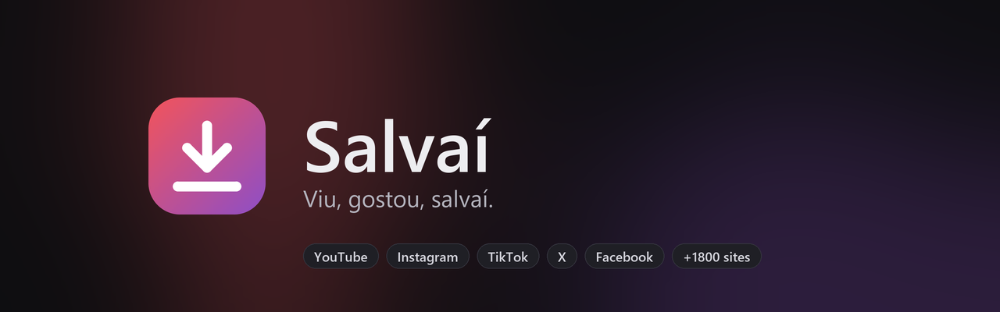
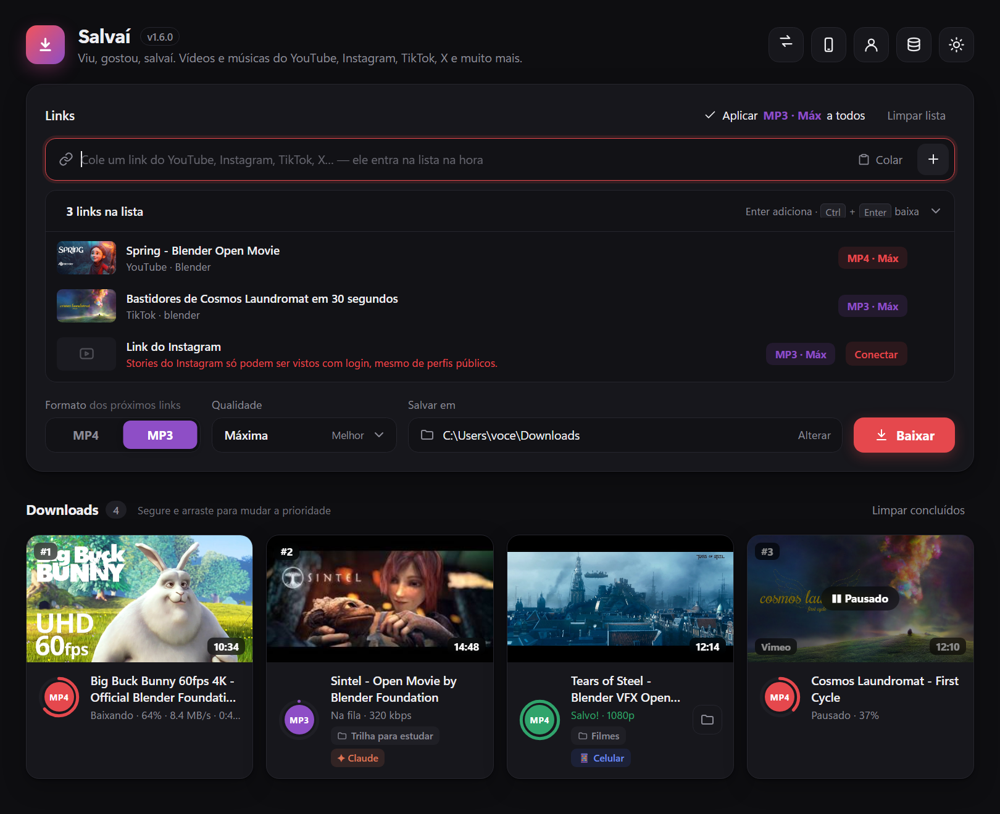
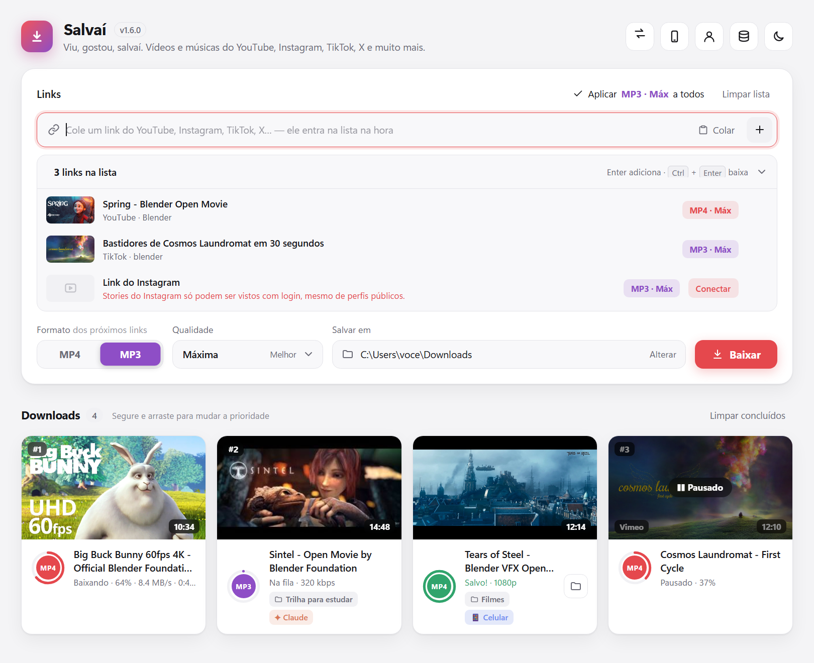
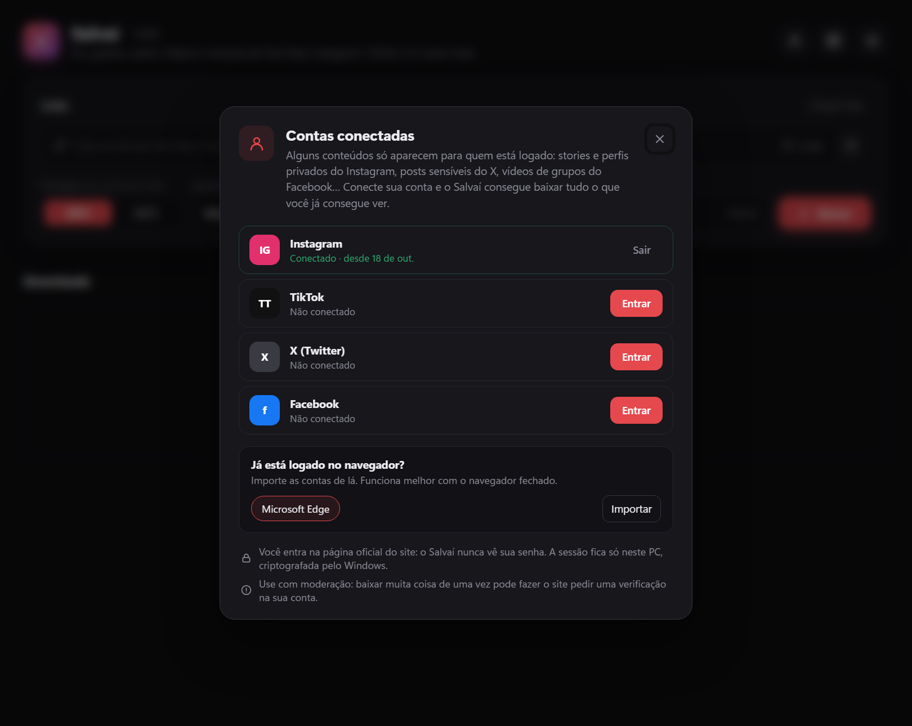
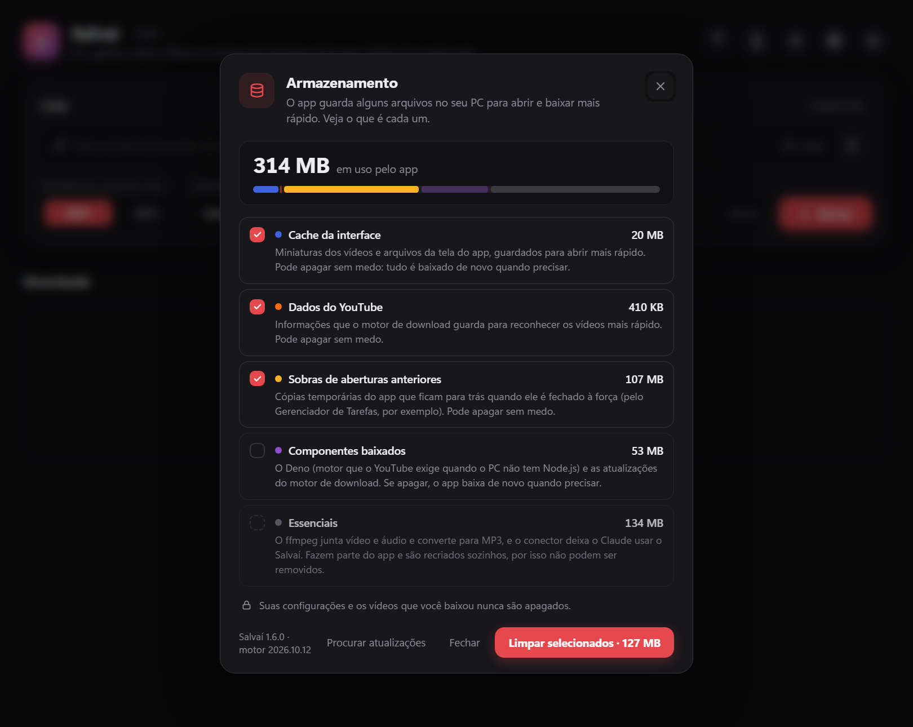
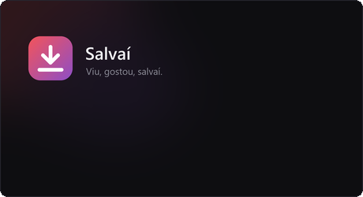

<p align="center">
  
</p>

<p align="center">
  <a href="https://github.com/Kaique292/salvai/releases/latest"></a>
  <a href="https://github.com/Kaique292/salvai/actions/workflows/ci.yml"></a>
  <a href="https://github.com/Kaique292/salvai/actions/workflows/ci.yml"></a>
  
  
  <a href="https://www.conventionalcommits.org/pt-br/"></a>
  <a href="https://buymeacoffee.com/kaiqueamaral"></a>
</p>

<p align="center">
  Baixe vídeos e músicas do <b>YouTube, Instagram, TikTok, X, Facebook</b> e de mais de 1.800 sites —<br>
  em <b>MP4</b> ou <b>MP3</b>, na qualidade que você quiser, com um app bonito e direto ao ponto.
</p>

<p align="center">
  <a href="https://github.com/Kaique292/salvai/releases/latest/download/Salvai.exe"><b>⬇️ Baixar para Windows</b></a>
  &nbsp;·&nbsp;
  <a href="#-o-windows-disse-que-é-vírus">O Windows disse que é vírus?</a>
  &nbsp;·&nbsp;
  <a href="#-usando-com-o-claude">Usar com o Claude</a>
</p>

<p align="center">
  
</p>

## ✨ O que ele faz

- **Cole e pronto.** Colou um link, ele entra na lista na hora, com miniatura, título e canal. Copiou um link fora do app? Ao voltar para o Salvaí ele já está preenchido — é só clicar no **+**.
- **Cada link com a sua configuração.** Um vídeo em MP4 1080p, outro em MP3 320 kbps, na mesma leva. Dá para trocar depois pelo selo de cada link.
- **Qualidade máxima por padrão.** Até 4K em vídeo; em áudio, o melhor disponível convertido para MP3 com capa e título embutidos.
- **Fila com prioridade.** Segure e arraste um card para mudar a ordem. Se o que estava baixando sair do primeiro lugar, ele pausa e continua depois de onde parou.
- **Qualquer site.** YouTube, Instagram (reels, posts, stories), TikTok, X, Facebook, Vimeo, Twitch e muito mais.
- **Contas conectadas.** Stories, perfis privados e posts sensíveis exigem login: você entra pela página oficial do site, dentro do app, e o Salvaí cuida do resto.
- **Mensagens claras.** Quando algo não dá certo, o app explica o porquê (perfil privado, precisa de login, conteúdo removido, site bloqueou…) e o que fazer.
- **Armazenamento transparente.** Veja quanto espaço o app usa, o que é cada coisa e limpe o cache com um clique.
- **Tema claro e escuro**, com uma transição suave.
- **Salvaí no celular.** Ligue o modo celular, aponte a câmera para o QR code e peça downloads pelo celular — depois salve os arquivos direto nele. Download interrompido continua de onde parou.
- **Continua trabalhando na bandeja.** Fechou a janela com downloads em andamento ou com o modo celular ligado? O Salvaí vai para a bandeja, avisa com uma notificação e segue trabalhando.
- **Funciona com o Claude.** Peça para o Claude buscar e baixar vídeos e músicas por você, já organizados em pastas.

## 📸 Telas

<table>
  <tr>
    <td width="50%"></td>
    <td width="50%"></td>
  </tr>
  <tr>
    <td align="center"><sub>Tema claro, com configuração por link</sub></td>
    <td align="center"><sub>Contas conectadas</sub></td>
  </tr>
  <tr>
    <td width="50%"></td>
    <td width="50%" align="center"></td>
  </tr>
  <tr>
    <td align="center"><sub>Armazenamento e cache</sub></td>
    <td align="center"><sub>Tela de carregamento</sub></td>
  </tr>
</table>

## ⬇️ Instalação

1. Baixe o **[Salvai.exe](https://github.com/Kaique292/salvai/releases/latest/download/Salvai.exe)** na página de [releases](https://github.com/Kaique292/salvai/releases/latest).
2. Coloque em uma pasta fixa, por exemplo `C:\Users\<você>\AppData\Local\Programs\Salvai\`.
3. Dê dois cliques. Pronto — não precisa instalar Python nem nada.

> Na primeira vez o app pode levar alguns segundos a mais: ele prepara o ffmpeg e, se o seu PC não tiver Node.js ou Deno, baixa o Deno uma única vez (o YouTube exige um motor JavaScript para liberar as qualidades mais altas).

## 🛡️ O Windows disse que é vírus?

**Não é.** Isso acontece porque o Salvaí não tem uma assinatura digital paga (um certificado de assinatura de código custa caro por ano) e porque apps empacotados em um único `.exe` costumam ser confundidos por antivírus. O código é aberto: está tudo aqui no repositório, e cada release é gerada automaticamente pelo GitHub a partir dele.

### "O Windows protegeu o computador" (SmartScreen)

1. Clique em **Mais informações**.
2. Clique em **Executar assim mesmo**.

Isso só aparece na primeira vez.

### O Windows Defender apagou ou bloqueou o arquivo

1. Abra **Segurança do Windows** → **Proteção contra vírus e ameaças** → **Histórico de proteção**.
2. Encontre o item do `Salvai.exe` e clique em **Ações** → **Permitir no dispositivo** (ou **Restaurar**).
3. Se quiser evitar que aconteça de novo: **Proteção contra vírus e ameaças** → **Gerenciar configurações** → **Exclusões** → **Adicionar uma exclusão** → **Pasta** e escolha a pasta onde está o Salvaí.

### O arquivo não abre (bloqueado por ter vindo da internet)

Clique com o botão direito no `Salvai.exe` → **Propriedades** → marque **Desbloquear** → **OK**.

### Quero conferir se o arquivo é o original

Cada release traz um `SHA256SUMS.txt`. No PowerShell, na pasta do arquivo:

```powershell
Get-FileHash .\Salvai.exe -Algorithm SHA256
```

O código exibido precisa ser igual ao do `SHA256SUMS.txt`. Você também pode enviar o arquivo ao [VirusTotal](https://www.virustotal.com) ou [gerar o executável você mesmo](#️-desenvolvimento).

## 🔐 Contas conectadas

Alguns conteúdos só aparecem para quem está logado: **stories do Instagram** (sempre, mesmo de perfis públicos), **perfis privados** (a conta precisa seguir o perfil), **posts sensíveis do X** e **vídeos de grupos do Facebook**.

No app, clique no ícone de pessoa → **Contas** → **Entrar**. Abre a página oficial do site; você entra normalmente e a janela fecha sozinha.

- O Salvaí **nunca vê sua senha** — quem recebe é o próprio site.
- A sessão fica **só neste PC**, criptografada pela proteção de dados do Windows.
- Já está logado no navegador? Dá para **importar** de lá (funciona melhor com o navegador fechado).
- Use com moderação: baixar muita coisa de uma vez pode fazer o site pedir uma verificação na sua conta.

## 📱 Salvaí no celular

> [!IMPORTANT]
> **O celular precisa estar no mesmo Wi-Fi do computador.** Se o computador estiver no cabo, conecte o celular ao Wi-Fi do mesmo roteador.

1. No app, toque no ícone de celular e ligue o **Modo celular**.
2. Aponte a câmera do celular para o **QR code**.
3. Pronto: cole links para baixar no PC, acompanhe o progresso e toque em **Salvar** para levar o arquivo para o celular.

- Não precisa instalar nada no celular — abre no navegador (Android e iPhone).
- Se o download para o celular for interrompido (o Wi-Fi caiu, a tela bloqueou…), ele **continua de onde parou**.
- No iPhone, os arquivos vão para **Arquivos → Downloads**; para colocar na galeria, abra o vídeo e toque em **Compartilhar → Salvar vídeo**.
- Funciona com cabo ou Wi-Fi no computador, em redes IPv4 e IPv6.
- **Segurança:** o modo celular vem desligado. Só aparelhos da sua rede local com o código do QR entram, e o código muda toda vez que você liga.

<details>
<summary><b>O celular não conecta?</b></summary>

- Confira se o celular está no **mesmo Wi-Fi** (e não nos dados móveis).
- Na primeira vez, o Windows pergunta se o Salvaí pode usar a rede: permita.
- Se o Windows marcou sua rede como **Pública**, o app avisa e oferece dois caminhos: marcar a rede como **Privada** (Configurações → Rede e Internet) ou o botão **Liberar no firewall**.
- Redes de visitantes de alguns roteadores isolam os aparelhos entre si; nesse caso use a rede principal.

</details>

## 🤖 Usando com o Claude

O Salvaí vem com um conector **MCP** (`salvai-mcp.exe`) que deixa o Claude buscar, baixar e organizar vídeos e músicas para você. Exemplo:

> _"Estou estudando estequiometria para o vestibular. Encontra 3 boas aulas no YouTube, baixa em 720p na pasta Vestibular/Química e uma playlist lo-fi em MP3 para eu ouvir estudando."_

Os downloads aparecem na fila do app com o selo **✦ Claude**, cada um na pasta que ele escolheu.

### Como conectar

1. Baixe o **[salvai-mcp.exe](https://github.com/Kaique292/salvai/releases/latest/download/salvai-mcp.exe)** e coloque **na mesma pasta** do `Salvai.exe`.
2. Conecte ao seu app de IA:

<details>
<summary><b>Claude Desktop</b></summary>

Abra **Configurações** → **Desenvolvedor** → **Editar configuração** e adicione em `claude_desktop_config.json`:

```json
{
  "mcpServers": {
    "salvai": {
      "command": "C:\\Users\\<você>\\AppData\\Local\\Programs\\Salvai\\salvai-mcp.exe"
    }
  }
}
```

Reinicie o Claude Desktop.

</details>

<details>
<summary><b>Claude Code</b></summary>

```powershell
claude mcp add --scope user salvai -- "C:\Users\<você>\AppData\Local\Programs\Salvai\salvai-mcp.exe"
```

</details>

<details>
<summary><b>Outros apps (Cursor, VS Code…)</b></summary>

Qualquer app que aceite servidores MCP locais (stdio) funciona: aponte o comando para o `salvai-mcp.exe`.

</details>

### O que o Claude consegue fazer

| Ferramenta       | Para que serve                                                       |
| ---------------- | -------------------------------------------------------------------- |
| `search_media`   | Busca no YouTube ou no SoundCloud                                    |
| `download_media` | Baixa um ou vários links, cada um com formato, qualidade e pasta     |
| `list_downloads` | Acompanha o progresso e espera terminar                              |
| `list_files`     | Lista o que já foi salvo                                             |
| `move_file`      | Reorganiza arquivos entre pastas (só dentro da pasta de downloads)   |
| `salvai_status`  | Mostra a pasta de downloads, as contas conectadas e o estado da fila |

Se o Salvaí estiver fechado, o conector abre o app sozinho. A comunicação acontece só dentro do seu PC (`127.0.0.1`), protegida por um token que muda a cada abertura. O Claude nunca recebe suas senhas e não consegue apagar nem sair da sua pasta de downloads.

## 🔄 Atualizações

Ao abrir, o Salvaí confere se há novidades:

- **Nova versão do Salvaí** — aparece um aviso com **Atualizar agora**: o app baixa a versão nova da página de releases (e o conector do Claude, se você usa), confere a assinatura SHA-256, troca os arquivos e reabre sozinho. Se algo der errado no meio, a versão atual continua intacta.
- **Motor de download** — os sites mudam o tempo todo, então o motor (yt-dlp) também é atualizado direto pelo app, sem precisar de uma versão nova do Salvaí.

Clicou em **Depois**? O aviso daquela versão não aparece mais; uma versão mais nova avisa de novo.

## 🧹 Armazenamento

No ícone de banco de dados você vê quanto o app ocupa e o que é cada parte: cache da interface, dados do YouTube, sobras de aberturas que foram fechadas à força e componentes baixados (Deno e atualizações do motor). Marque o que quiser e limpe — **suas configurações e os vídeos baixados nunca são apagados**.

Os vídeos não passam pelo cache: vão direto para a pasta escolhida, e os pedaços temporários do download são apagados assim que o arquivo fica pronto. As sobras de aberturas fechadas à força são limpas sozinhas na próxima abertura. Os ~90 MB que sempre ficam são o **ffmpeg**, essencial para juntar vídeo e áudio e converter para MP3 — por isso ele aparece travado na lista.

## ❓ Perguntas frequentes

**Um download falhou dizendo que precisa de login.** Conecte a conta do site em **Contas** e tente de novo — o app refaz sozinho o que falhou por esse motivo.

**Perfil privado.** Só funciona se a conta conectada seguir o perfil. É a mesma regra do site: o Salvaí baixa apenas o que você já consegue ver.

**Um site parou de funcionar.** Os sites mudam com frequência. Atualize para a versão mais recente do Salvaí, que traz o motor de download atualizado.

**Onde ficam os dados do app?** Em `%APPDATA%\Salvai` (configurações, contas criptografadas e componentes).

## 🔒 Segurança e privacidade

- **Sem telemetria:** nada sobre o seu uso sai do seu PC.
- **Contas criptografadas** pelo Windows, e o app nunca vê sua senha.
- **Modo celular protegido:** desligado por padrão, desliga sozinho após 30 minutos sem uso, só aceita aparelhos da sua rede com o código do QR e só entrega arquivos de mídia.
- **Atualizações conferidas:** cada arquivo baixado (app, motor de download e Deno) é verificado pelo SHA-256 oficial antes de ser usado.

Os detalhes, os limites conhecidos e como reportar uma falha estão em [SECURITY.md](SECURITY.md).

## ⚖️ Uso responsável

Baixe apenas conteúdo que você tem o direito de guardar e respeite os termos de uso de cada site e os direitos dos criadores.

## 🛠️ Desenvolvimento

**Requisitos:** Windows 10/11, [Python 3.14](https://www.python.org/downloads/) e [Node.js 24](https://nodejs.org/) com [Yarn 4](https://yarnpkg.com/) (via Corepack).

```powershell
git clone https://github.com/Kaique292/salvai.git
cd salvai
py -3.14 -m venv .venv
.venv\Scripts\python.exe -m pip install -r requirements-dev.txt
corepack enable
yarn install
```

| Comando               | O que faz                                                 |
| --------------------- | --------------------------------------------------------- |
| `yarn dev`            | Abre o app a partir do código                             |
| `yarn build`          | Gera `dist\Salvai.exe`, `dist\salvai-mcp.exe` e os hashes |
| `yarn lint`           | Confere formatação e qualidade (Prettier + Ruff)          |
| `yarn format`         | Formata tudo                                              |
| `yarn test`           | Roda todos os testes (Python e interface) com cobertura   |
| `yarn coverage:badge` | Atualiza o badge de cobertura depois dos testes           |

### Estrutura

```
salvai/
├─ src/
│  ├─ app.py            app (janela, fila, downloads, contas, ponte do MCP)
│  ├─ salvai_mcp.py     conector MCP
│  └─ ui/               interface (HTML, CSS e JavaScript)
├─ assets/              ícone, logo e tela de carregamento
├─ tests/              testes do app (pytest) e da interface (vitest)
├─ scripts/             geração da arte, build e badge de cobertura
├─ packaging/           configuração do PyInstaller
├─ docs/images/         imagens deste README
└─ .github/             verificação, releases e modelos de issue
```

### Commits e versões

Os commits seguem o padrão **[Conventional Commits](https://www.conventionalcommits.org/pt-br/)**, conferido automaticamente a cada commit (commitlint + husky). Antes de cada commit, o código é formatado (Prettier e Ruff).

| Tipo       | Quando usar          | Efeito na versão |
| ---------- | -------------------- | ---------------- |
| `feat`     | recurso novo         | `1.x.0`          |
| `fix`      | correção             | `1.0.x`          |
| `perf`     | desempenho           | `1.0.x`          |
| `refactor` | mudança interna      | —                |
| `docs`     | documentação         | —                |
| `build`    | build e dependências | —                |
| `ci`       | automação            | —                |
| `chore`    | manutenção           | —                |

Exemplo: `feat: adiciona suporte a playlists do SoundCloud`. Um `!` depois do tipo (`feat!:`) marca uma mudança incompatível e sobe a versão principal.

As versões e o [CHANGELOG](CHANGELOG.md) são gerados pelo [release-please](https://github.com/googleapis/release-please): a cada push na `main` ele abre um PR de release; ao aprovar, a versão é publicada e o GitHub gera e anexa o `Salvai.exe`, o `salvai-mcp.exe` e o `SHA256SUMS.txt`.

## 🙏 Feito com

[yt-dlp](https://github.com/yt-dlp/yt-dlp) · [FFmpeg](https://ffmpeg.org/) · [pywebview](https://pywebview.flowrl.com/) · [Deno](https://deno.com/) · [SortableJS](https://sortablejs.github.io/Sortable/) · [Model Context Protocol](https://modelcontextprotocol.io/) · [PyInstaller](https://pyinstaller.org/)

O FFmpeg é distribuído junto com o app sob a licença GPL; o código-fonte está disponível em [ffmpeg.org](https://ffmpeg.org/download.html).

## ☕ Apoie o projeto

Se o Salvaí te ajudou, considere pagar um café — isso ajuda a manter o app atualizado.

<p align="center">
  <a href="https://buymeacoffee.com/kaiqueamaral"></a>
</p>

<p align="center">
  <a href="https://github.com/Kaique292/salvai/releases/latest"></a>
  <a href="https://buymeacoffee.com/kaiqueamaral"></a>
</p>
